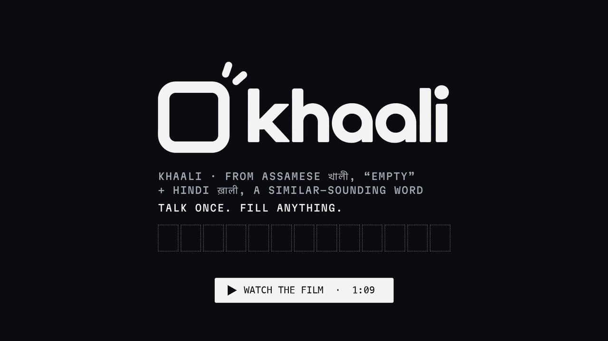

# Khaali

**Talk once. Fill anything.**

Khaali is a Chrome extension that fills Indian government forms for you. You save your details once; on a portal, Khaali recognises the fields, shows you exactly what it will share, and fills the form only after you approve. It attaches your documents from a folder in your own Google Drive, resizes your photo and signature to each form's rules, and lets you dictate long answers in ten Indian languages.

[](https://github.com/bhabishnu/khaali/raw/main/promo/khaali-promo.mp4)

▶ **[Download the film](https://github.com/bhabishnu/khaali/raw/main/promo/khaali-promo.mp4)** (1:09, MP4 with sound, 22 MB)

## Contents

- [Features](#features)
- [How it works](#how-it-works)
- [Privacy](#privacy)
- [Requirements](#requirements)
- [Installation](#installation)
- [Setting up your profile](#setting-up-your-profile)
- [Filling a form](#filling-a-form)
- [Trying it on the demo form](#trying-it-on-the-demo-form)
- [Google Drive sign-in](#google-drive-sign-in)
- [Project layout](#project-layout)
- [Status and known limitations](#status-and-known-limitations)
- [Credits](#credits)

## Features

**Approval-first autofill.** Khaali detects name, date of birth, gender, address, PIN code, state, district, mobile number and email fields, lists them with the values it will use, and fills nothing until you choose *Approve & fill*. Fields that belong to someone else, such as a father's, mother's, spouse's or nominee's name, are left for you.

**Built for Indian addresses.** Your address is stored in parts: house, street, village or city, district, state and PIN. Typing a PIN fills in the district and state from an offline directory of 19,300 PIN codes. On a portal, Khaali picks the state first so the district list can load, then matches old or alternate spellings such as *BANGALORE URBAN* for Bengaluru Urban or *ORISSA* for Odisha.

**Start from a document.** Add your Aadhaar, PAN card or passport as a photo, scan or downloaded PDF, and Khaali offers to fill your profile from it. Aadhaar is read from its Secure QR code, falling back to the printed text; passports from the machine-readable lines; and PAN cards with on-device OCR. Password-protected e-Aadhaar and e-PAN PDFs ask for the password, which is never stored. You review every value before it is saved.

**Documents from your own Drive.** The Khaali Locker is a folder in your Google Drive for your Aadhaar, PAN card, passport, driving licence, voter ID, class 10 and 12 marksheets, address proof, and caste and income certificates. When a form asks for one, Khaali offers to attach it, again only after you approve.

**Photo and signature, fitted to the form.** Portals state limits like *JPG, 3.5 cm × 4.5 cm, 20–50 KB*. Khaali reads those rules next to the upload field, crops and resizes your saved photo or signature, and searches for the best JPEG quality that fits inside the size limit.

**Voice input for long answers.** For fields like *Reason for application*, open the microphone in the Khaali panel and speak. Supported languages: English (India), Hindi, Bengali, Marathi, Tamil, Telugu, Gujarati, Kannada, Malayalam and Urdu. When Chrome can recognise a language on your computer, your voice never leaves the device; otherwise Khaali asks before Chrome's online speech service is used.

**Reads Hindi labels.** Fields labelled पिन, राज्य, ज़िला, शहर, गांव or पता, and uploads labelled फोटो or हस्ताक्षर, are recognised alongside their English equivalents.

## How it works

1. **Detect.** On a supported site, Khaali scans the page for fields it recognises and upload inputs it can fill.
2. **Offer.** A small panel appears in the top-right corner of the page with what it found.
3. **Approve.** You see each field and the value that will go into it. Nothing happens until you approve.
4. **Fill.** Fields are filled one at a time and highlighted as they change, with dependent dropdowns handled in order.
5. **Attach.** Documents, photos and signatures are offered next, each behind its own approval.
6. **Review.** A summary lists everything that was filled or attached, so you can check the form before you submit it.

## Privacy

- Your profile, photo and signature are kept in Chrome's extension storage on your computer. There is no Khaali server.
- Documents you read to fill your profile are processed on your computer. They are uploaded only if you choose to keep a copy in your Khaali Locker. Document numbers, and the photos and signatures inside documents, are not kept in your profile.
- The Khaali Locker uses Google's `drive.file` permission, so Khaali can see only the files it adds to its own folder, never the rest of your Drive.
- Nothing is filled, shared or downloaded without your approval, and Khaali never submits a form.

## Requirements

- Google Chrome on desktop. Use a recent version for on-device speech recognition.
- A Google account, only if you use the Khaali Locker.
- Python 3, only to serve the demo form locally.

There is no build step and nothing to install from a package manager: the extension is plain HTML, CSS and JavaScript, and its libraries are bundled in `lib/`.

## Installation

Khaali is not on the Chrome Web Store yet. Install it from source:

1. **Get the code.**

   ```sh
   git clone https://github.com/bhabishnu/khaali.git
   ```

   Or download the repository as a ZIP from GitHub and extract it.

2. **Open the extensions page.** Go to `chrome://extensions` in Chrome.

3. **Turn on Developer mode** with the switch in the top-right corner.

4. **Load the extension.** Click **Load unpacked** and select the `khaali` folder, the one that contains `manifest.json`.

5. **Pin it (optional).** Click the puzzle-piece icon in Chrome's toolbar and pin Khaali for quick access.

**Updating.** Pull the latest changes with `git pull`, then click the reload icon on Khaali's card in `chrome://extensions`.

## Setting up your profile

Click the Khaali icon in the toolbar. On a page Khaali doesn't run on, this opens the settings page.

1. **Start with a document (optional).** Choose your Aadhaar, PAN card or passport: a photo, a scan, or the PDF you downloaded. You can pick the front and back together. Check the values Khaali found, then choose *Use these details*.
2. **Your details.** Confirm your full name, date of birth, gender, mobile number and email address.
3. **Address.** Enter your house and street, then your PIN code. The district and state fill in automatically and stay highlighted until you review them.
4. **Photo and signature.** Add a passport-size photo and a photo of your signature. Khaali keeps the originals and makes a resized copy for each form.
5. **Khaali Locker (optional).** Choose *Connect Google Drive*, then add the documents you upload often.
6. Choose **Save changes**.

## Filling a form

1. Open an application form on a supported site. Khaali runs on `*.gov.in` and `*.nic.in` portals, Google Forms, and `localhost` for testing.
2. When the panel offers to fill the page, choose **Autofill this page**, review the list, and choose **Approve & fill**.
3. If the form asks for documents, approve the ones Khaali offers from your Khaali Locker, and your photo and signature.
4. For a free-text answer, click into the field, choose the microphone in the panel header, pick a language and choose **Start speaking**. Only finished phrases are written into the field.
5. Check the form and submit it yourself.

On a supported page, the toolbar icon opens the panel at any time.

## Trying it on the demo form

The repository includes a sample driving-licence application for testing. It is a local page, not a government site.

```sh
cd khaali
python3 -m http.server 8000
```

Then open <http://localhost:8000/demo/form.html> with Khaali installed and your profile saved.

## Google Drive sign-in

The Khaali Locker signs in through Chrome's identity API with the OAuth client in `manifest.json`. That client is tied to Khaali's extension ID, which the `key` field in `manifest.json` keeps the same on every install.

- If sign-in fails, the client's consent screen may still be in testing mode, which only allows Google accounts added as test users. Ask the maintainers to add your account.
- To use your own Google Cloud project, enable the Google Drive API, create an OAuth client of type *Chrome extension* for Khaali's extension ID (shown on its card in `chrome://extensions`), and replace `oauth2.client_id` in `manifest.json`.

Everything except the Khaali Locker works without signing in.

## Project layout

```
manifest.json     extension manifest (Chrome needs it at the root)
src/
  background.js   service worker: Google sign-in and the Drive locker
  content.js      the in-page panel: field detection, filling, voice input
  kinds.js        document types and how forms label them
  documents.js    reads an Aadhaar, PAN card or passport (photo or PDF) on this computer
  options.html    settings page
  options.js
assets/           fonts, icons, brand board, video poster
lib/              jsQR, Tesseract.js (English) and pdf.js, bundled so nothing is fetched
data/pins.json    offline PIN → district → state directory (data.gov.in)
demo/form.html    local test form
promo/            khaali-promo.mp4, the promo film (its source stays local)
```

## Status and known limitations

Khaali is an early release (version 0.1.0) under active development.

- Profile data is stored unencrypted in Chrome's extension storage. A PIN lock with encryption is planned.
- Khaali runs only on the sites listed above. To use it on another portal, such as a bank or exam site, add the site's address to `content_scripts.matches` in `manifest.json`.
- Field detection relies on labels, so unusual layouts may leave some fields for you to fill by hand.
- OCR for PAN cards and printed Aadhaar text supports English only.

## Credits

- [jsQR](https://github.com/cozmo/jsQR), [Tesseract.js](https://github.com/naptha/tesseract.js) and [pdf.js](https://github.com/mozilla/pdf.js), licensed under Apache 2.0. Their licences are in `lib/`.
- [Archivo](https://github.com/Omnibus-Type/Archivo) and [Martian Mono](https://github.com/evilmartians/mono), licensed under the SIL Open Font License (`assets/fonts/OFL.txt`).
- PIN code directory from the All India Pincode Directory, Department of Posts, published on [data.gov.in](https://data.gov.in) under the Government Open Data License – India.
